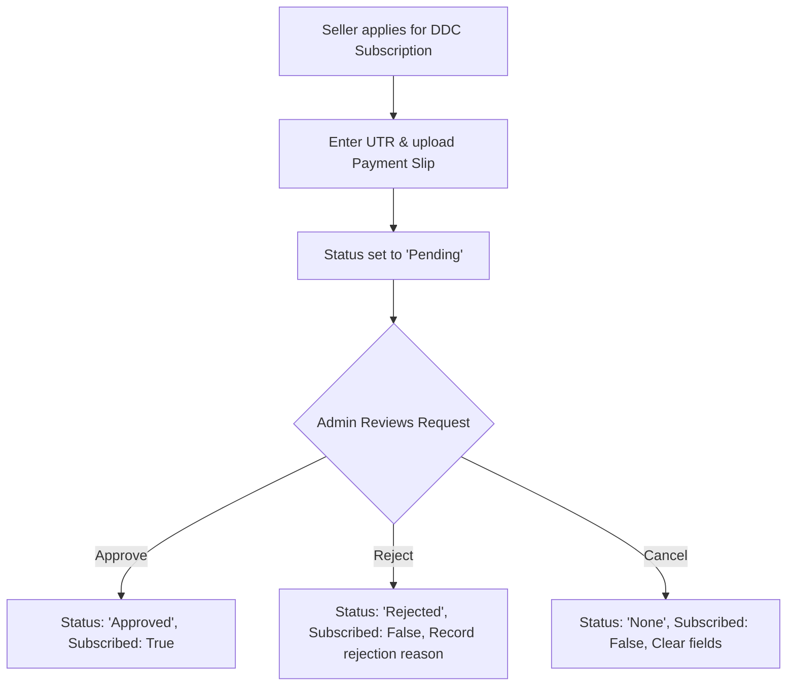

# Business Processes

This document details the business logic, workflows, and calculations executed by the system.

---

## 1. DDC Model Subscription Workflow

The District Distribution & Display Centre (DDC) subscription model operates under an admin-approved manual payment process:

### Business Rules
*   **Eligibility Rule**: Sub-sellers can always subscribe to the DDC model. A Parent/Main Seller can only subscribe if they do NOT have any sub-sellers. If they have sub-sellers, they are ineligible, and their sub-sellers must subscribe individually.
*   **Fees**: A flat onboarding fee (e.g. ₹10,000) is displayed on the payment modal along with the banking QR code.
*   **Re-application**: If rejected, the vendor is shown the rejection reason on their profile page and is allowed to re-submit new details (UTR / Slip) to restart the validation.

---

## 2. Product Code & Sequence Generation

Product codes are automatically generated inside the `Product` model `booted()` event on creation. 

*   **Format**: `{CleanSellerId}{SequenceNumber}` (e.g. `1001000111`)
*   **CleanSellerId**: Obtained by stripping out the string `"IMV"` from the seller's profile `seller_id`. If empty, defaults to `'1001'`.
*   **SequenceNumber**:
    *   If the seller has previous products matching `{CleanSellerId}%`, the sequence is incremented by 1 based on the sequence suffix of the latest product code.
    *   If no previous products exist, the sequence starts at `111` (e.g. `1001000111`).
    *   The sequence number is padded to a 6-digit string: `str_pad($nextSequence, 6, '0', STR_PAD_LEFT)`.
    *   A lookup checks for code uniqueness before saving to prevent duplicate database constraints.

---

## 3. District Distribution Center (DDC) Stock In

When a DDC receives stock from a Vendor for an accepted Purchase Order:

1.  **DDC Invoice Mandatory Check**: The DDC must first upload their DDC invoice number and file attachment before stock-in is allowed.
2.  **Stock In Calculation**:
    *   `SupplyQty` = The accepted PO item quantity.
    *   `DamageQty`, `ShortageQty`, `ExcessQty` = Manually recorded by the DDC.
    *   `NetQty` = `SupplyQty - DamageQty - ShortageQty + ExcessQty`.
    *   If `NetQty` is negative, the transaction is rejected.
3.  **Inventory Log**:
    *   If `NetQty > 0`, the system creates or updates a record in the `ddc_inventories` table matching `ddc_id`, `product_id`, `mrp` (received MRP), `mfg_date`, `expire_date`, and `batch_number`.
    *   The item's historical `purchase_price` is persisted to prevent pricing mismatches on future price changes.
4.  **Order Transition**:
    *   When all accepted items in a PO are marked as `is_stocked_in`, the Purchase Order status is automatically updated to `'Received'`.

---

## 4. Wallet & Security Calculations

*   **DDC Wallet**: Used to fund Purchase Orders. When a DDC submits a deposit request, it must be approved by the Admin before the wallet balance is incremented.
*   **Order Payments**: Checking out a DDC Purchase Order deducts the amount directly from the DDC's active wallet balance. If the wallet has insufficient funds, checkout is blocked.
*   **ADC Checkout**: ADC agents checkout retail orders through the main storefront. The subtotal is calculated as tax-exclusive, and GST is calculated and displayed as a separate line item before displaying the final payable amount.

---

## 5. Vendor KYC Review Flow

*   **Vendor Submissions**: Vendors upload multiple certificates (GST, PAN, Udyam, Incorporation, Cancelled Cheque, FSSAI, Trade License).
*   **Admin Audit**: The Admin reviews the documents and updates the KYC status (`PENDING`, `APPROVED`, `REJECTED`).
*   **Catalog Sync**: Products submitted by a Vendor only become visible on the public storefront once the Vendor's KYC is `APPROVED` and the specific products are marked as `Approved` by the admin.

---

## 6. Product Name Selection Logic (Regional Products)

*   **Product Name is mandatory**: Product Name cannot be left blank.
*   **DDC Inventory Only Search**: While entering Product Name, search is strictly scoped to the DDC's own inventory (`ddc_inventories` & `ddc_local_products` for that specific `ddc_id`). Global seller products table is not queried.
*   **Strict Code & Name Deduplication**: Product matches are deduplicated by unique Product Code and normalized Product Name so no duplicate entries ever appear in suggestions.
*   **MSME vs Regional Tagging**: Each suggestion explicitly displays a badge identifying its origin (`✓ MSME Product` / `✓ REGIONAL Product`).
*   **Create New Regional Product Option**: Only if no suitable product is found should the user select the **"+ Create New Regional Product"** option.
*   **Auto-generated Code**: A newly created product receives an auto-generated code `LCLxxxxx` (e.g. `LCL000001`).

